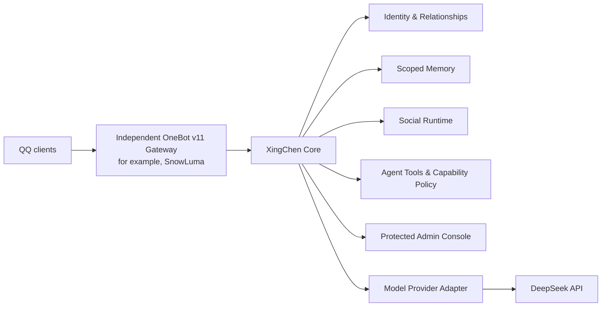

# moss（原 XingChen Core）

面向 QQ 社交场景的 Java AI Agent Runtime。

**A Java social AI runtime with identity, memory, tools, OneBot, and a protected admin console.**

[](https://openjdk.org/projects/jdk/21/)
[](https://spring.io/projects/spring-boot)
[](LICENSE)
[](https://github.com/suisui0601a-pixel/XingChen/actions/workflows/ci.yml)

moss is a Java 21 application for building a social AI runtime around durable conversations, identity, relationships, memory, bounded agent tools, and model-provider adapters. It uses Spring Boot and SQLite and provides a protected bilingual administration console. QQ connectivity is provided by an independently deployed OneBot v11 gateway; that gateway is not part of this repository or container image.

项目现名为 **moss**。仓库 URL、Java package、`XINGCHEN_*` 配置键及数据路径暂时保留原工程标识，以保持已有配置与持久化状态兼容。现有许可证和作者声明不变。

## Current status

| Area | Status |
| --- | --- |
| Core runtime, persistence, and protected Admin Console | Implemented; automated tests available |
| Identity, relationships, and scoped memory | Implemented |
| Agent tools and capability policy | Implemented |
| DeepSeek provider and OneBot v11 integration | Implemented; HTTP and WebSocket credentials are independent |
| Wake/access behavior and isolated runtime acceptance | Implemented; automated isolated acceptance available |
| SocialRuntime without DSH | Implemented; DSH is an independent integration |
| Native OneBot production cutover | Validated in a controlled deployment; deployment-specific identities, secrets, and private prompt data remain unpublished |
| Voice features | In progress / not generally available |
| General public release | In progress |

This status describes the current development line, not an availability or support guarantee. See the source-available terms in [LICENSE](LICENSE).

## Architecture



The Gateway is a separate operator-managed service. XingChen does not contain QQ clients, login credentials, QR-login automation, or SnowLuma binaries.

Local development binds the Console to `127.0.0.1:3200`. In a container, the app
listens on its container interface for service-to-service traffic; deployment
examples publish only to host loopback by default and retain the explicit
remote-bind guard.

## Features

### Social runtime

- Private and group conversation handling through the OneBot v11 boundary.
- Durable, serialized turn processing with replay/deduplication and restart-aware state.
- Explicit wake and access policies rather than implicit unrestricted tool access.
- Wake evaluation applies access control before invalid/self/system filtering and explicit, contextual, then ordinary-random triggers. Random probability affects only eligible ordinary messages.

#### “偶尔冒泡”的实际范围

- **收到普通群消息后的概率参与**与**闲置主动冒泡**是两套独立策略；启用其中一项不会自动启用另一项。
- 在 Console「社交设置」配置普通消息参与概率；API 字段 `ordinaryMessageProbability` 使用 `0–1`，界面按百分比显示。默认 `0.05`（5%）。V30 首次升级备份并替换旧的对应配置；之后保存的会话级覆盖仍优先于全局配置。
- 例如 `0.05` 表示每条符合条件的普通入站消息有 5% 概率进入模型，不是每 20 条保证回复一次。
- 访问控制、自身/无效消息过滤、休眠等条件仍生效。私聊、Owner 消息，以及启用的 @、回复机器人、问句或配置成员等唤醒条件，会直接参与模型，不受该普通群消息概率控制。
- 进入模型后仍可能选择 `NO_REPLY`；限流拒绝及 `UNKNOWN` 出站不会被当成成功回复，也不会自动盲目重发。

- 公开版普通群消息随机插话默认 **5%**。凌晨 **00:00–06:00** 普通消息静默，仅直接 @ 本机器人与配置 Owner 的私聊可继续原规则。
- 每日 **07:00 早安 / 22:50 晚安** 独立定时问候；07:00 不被随机冒泡的 23:00–08:00 安静时段误挡。仍服从权限、近期活动及会话状态保护，不补发错过的问候。

#### 无新消息时主动冒泡

- 在 Console「社交设置」分别管理私聊 / 群聊主动冒泡，默认均开启；访问控制仍需单独允许。群聊不会借用 Owner 的恢复权限取得主动发言资格。
- 默认至少闲置 120 分钟、每 120 分钟独立抽样一次，命中概率 30%，冷却 120 分钟，每会话每天最多 8 次随机尝试。默认 `Asia/Shanghai` 23:00–08:00 安静；可热更新全局或会话级覆盖。
- 仅检查最近 24 小时有真实入站的会话；WAIT、休眠、CLOSED_AGENT、忙碌或断线时不发起。模型可选择不说话；一次尝试最多一条文字，不开放 Agent 工具写入或工具发送。
- 随机冒泡与每日问候各有全实例每小时 4 次模型尝试上限。NO_REPLY、取消、失败和 UNKNOWN 均消耗已准入的尝试预算；概率未命中不消耗模型额度，但不会每分钟重复抽样。
- 使用持久化定时准入日志与既有出站 Ledger。重启不补发旧定时任务，UNKNOWN 不重试；崩溃可能丢失本次冒泡，不能宣称端到端 exactly-once。
- 新入站优先；群聊主动上下文仅使用本群与全局可见记忆，不借用最后发言人的私有记忆或 Owner 身份。
- [主动冒泡配置、边界与回滚说明](docs/PROACTIVE_PARTICIPATION.md)。本次升级到 V30：备份并一次性覆盖旧社交策略及对应会话覆盖；后续新保存配置保留。升级前按旧版恢复工具创建并校验匹配备份。

### Identity and memory

- Stable platform identity and relationship/address-term management.
- Scoped memory with provenance and visibility controls.
- Prompt/persona configuration separated from transport and persistence contracts.

### Agent and integrations

- Provider-neutral model and tool contracts with provider-specific behavior kept in adapters.
- QQ, memory, sticker, and slang tool families subject to catalog and capability policy.
- DeepSeek tool-name transport mapping preserves XingChen's canonical internal names.

### Administration

- Protected bilingual Web Console for runtime, identity, prompts, models, OneBot, access, usage, and operations.
- SecretStore-backed provider and gateway credentials.
- Separate OneBot HTTP and forward-WebSocket credentials, independently saved and cleared without echoing token values.
- Container deployment with non-root runtime, read-only root filesystem, and persistent data volume.

## Quick start

Requirements: JDK 21 and Docker Compose v2 for container deployment. The Gradle Wrapper downloads its pinned distribution on first use; frontend dependencies are installed by the build. For local development, see [Contributing](CONTRIBUTING.md).

```powershell
./gradlew.bat test
./gradlew.bat bootJar
```

For the hardened container, persistence, administrator initialization, and a separately managed OneBot Gateway, follow [Deployment](docs/DEPLOYMENT.md). Do not put secrets in Compose, Git, issue reports, or shell history.

`GET /health` is the basic liveness endpoint. Real provider tests are opt-in via
`./gradlew.bat liveTest`; they require the explicit live-test flag and a dedicated
test key. Normal tests use fixtures and do not call a provider.

## Documentation

- [Architecture](docs/ARCHITECTURE.md) · [Agent Runtime](docs/AGENT_RUNTIME.md) · [Memory Model](docs/MEMORY_MODEL.md)
- [Deployment](docs/DEPLOYMENT.md) · [Bilingual agent deployment](docs/AGENT_DEPLOYMENT_BILINGUAL.md) · [Admin Initialization](docs/ADMIN_INITIALIZATION.md) · [Admin credentials](docs/ADMIN_CREDENTIALS.md)
- [FAQ](docs/FAQ.md) · [Backup & Restore](docs/BACKUP_RESTORE.md) · [Sticker bulk import](docs/STICKER_BULK_IMPORT.md) · [Sanitized operations reports](docs/reports/README.md)
- [Model Provider](docs/MODEL_PROVIDER.md) · [OneBot Adapter](docs/ONEBOT_ADAPTER.md) · [SnowLuma Gateway Contract](docs/SNOWLUMA_GATEWAY_CONTRACT.md)
- [Security](SECURITY.md) · [All documentation and historical reports](docs/README.md)

## Screenshots

No scrubbed, publishable console screenshots are included yet. We will add genuine screenshots only after reviewing them for credentials, private conversations, account identifiers, and infrastructure details. See [`docs/assets/screenshots/`](docs/assets/screenshots/).

## Security

Secrets do not belong in Git. The Console requires authentication, agent tools use capability allowlists, and the production container is configured non-root with a read-only root filesystem and no Docker socket. Keep the independently deployed Gateway isolated from public ingress. Provider diagnostics are sanitized; see [SECURITY.md](SECURITY.md) for the reporting process and deployment boundaries.

## License

XingChen is **source-available, not OSI open source**. Personal, learning, and non-commercial use are governed by [LICENSE](LICENSE); commercial use requires prior written authorization. Third-party components retain their own terms in [THIRD_PARTY_NOTICES.md](THIRD_PARTY_NOTICES.md).
